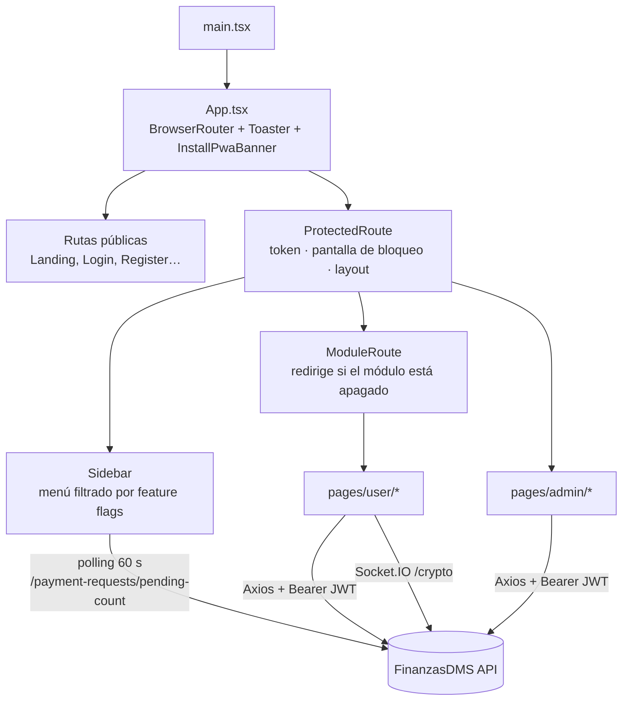
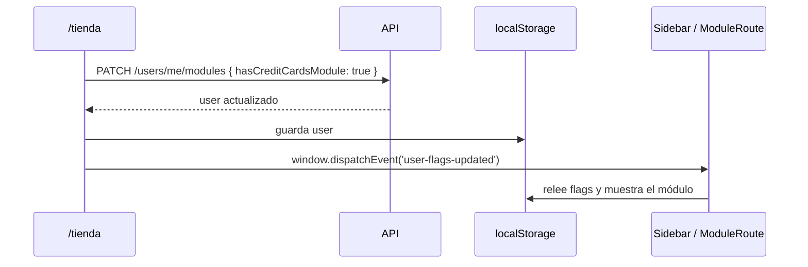

# FinanzasDMS Web

> Frontend de **FinanzasDMS**: SPA instalable (PWA) para gestionar préstamos familiares, pagos SPEI, portafolio de inversión, tarjetas, suscripciones y cripto.


---

## Índice

1. [Stack](#stack)
2. [Arquitectura](#arquitectura)
3. [Estructura de carpetas](#estructura-de-carpetas)
4. [Rutas](#rutas)
5. [Conceptos clave](#conceptos-clave)
6. [Patrones de código](#patrones-de-código)
7. [Guía de estilo UI](#guía-de-estilo-ui)
8. [Puesta en marcha](#puesta-en-marcha)
9. [Scripts](#scripts)
10. [Cómo agregar una página nueva](#cómo-agregar-una-página-nueva)

---

## Stack

| Capa | Tecnología |
|---|---|
| Framework | React 19 + TypeScript |
| Build / dev server | Vite 8 |
| Estilos | Tailwind CSS 4 (`@tailwindcss/vite`) |
| Enrutamiento | React Router DOM 7 |
| HTTP | Axios |
| Tiempo real | `socket.io-client` |
| Gráficas | Recharts |
| Íconos | lucide-react |
| Notificaciones | Sonner |
| PWA | `vite-plugin-pwa` (Workbox, `generateSW`) |

---

## Arquitectura



**Ideas principales:**
- **No hay estado global** (Redux ni Context). El `token` y el `user` viven en `localStorage`, y cada página pide sus propios datos.
- **No hay un cliente Axios centralizado.** Cada página arma sus llamadas con `authHeaders()`.
- La **seguridad real está en el backend**: las rutas `/admin/*` del frontend no validan el rol, pero la API responde 403 con `RolesGuard` a quien no sea admin.

---

## Estructura de carpetas

```
fintech-web/
├── public/                    ← favicon, íconos PWA (icons/)
├── vite.config.ts             ← plugins: react, tailwind, PWA (manifest + Workbox)
└── src/
    ├── main.tsx               ← punto de entrada
    ├── App.tsx                ← definición de rutas + ModuleRoute
    ├── index.css              ← tokens de color (@theme) + clases glass
    ├── components/
    │   ├── ProtectedRoute.tsx ← guard de auth + layout + pantalla de cuenta bloqueada
    │   ├── Sidebar.tsx        ← navegación dinámica, progreso de nivel, badge SPEI
    │   ├── EmptyState.tsx     ← estado vacío reutilizable
    │   ├── InstallPwaBanner.tsx
    │   └── InstallAppButton.tsx
    ├── hooks/
    │   └── usePwaInstall.ts   ← captura `beforeinstallprompt`
    └── pages/
        ├── public/            ← Landing, Login, Register, ForgotPassword, ResetPassword,
        │                        VerifyEmail, Privacy, Terms, Contact
        ├── user/
        │   ├── Dashboard.tsx        ← patrimonio neto y resumen por módulo
        │   ├── Profile.tsx
        │   ├── ModuleStore.tsx      ← /tienda: activar módulos y Premium cripto
        │   ├── AccountMonitor.tsx   ← monitoreo de saldo promedio y gasto
        │   ├── Crypto.tsx           ← portafolio cripto + tendencias + alertas WS
        │   ├── Investments.tsx      ← "Gana Dinero"
        │   ├── loans/               ← Loans, LoanDetail, LoanSimulator, LoanRequest
        │   ├── portfolio/           ← Portfolio, PortfolioDetail
        │   ├── credit-cards/        ← CreditCards, CreditCardDetail
        │   └── subscriptions/       ← Subscriptions, SharedSubscriptions
        └── admin/             ← AdminHome, AdminRequests, AdminActiveLoans, AdminLoanDetail,
                                 AdminPayments, AdminBanks, AdminMigration, AdminReferrals, AdminUsers
```

---

## Rutas

### Públicas

| Ruta | Página |
|---|---|
| `/` | `Landing` |
| `/login` · `/register` | `Login` · `Register` |
| `/forgot-password` · `/reset-password` | Recuperación de contraseña |
| `/verify-email` | Activación de la cuenta desde el email |
| `/privacy` · `/terms` · `/contact` | Páginas legales y de contacto |

### Usuario (requieren sesión)

| Ruta | Página | Flag requerida |
|---|---|---|
| `/dashboard` | `Dashboard` | — |
| `/loans` · `/loans/:id` | `Loans` · `LoanDetail` | `hasLoansModule` |
| `/loans/simulator` · `/loans/request` | `LoanSimulator` · `LoanRequest` | `hasLoansModule` |
| `/credit-cards` · `/credit-cards/:id` | `CreditCards` · `CreditCardDetail` | `hasCreditCardsModule` |
| `/subscriptions` · `/subscriptions/shared` | `Subscriptions` · `SharedSubscriptions` | `hasSubscriptionsModule` |
| `/crypto` | `Crypto` | `hasCryptoModule` |
| `/investments` | `Investments` | `hasMakeMoneyModule` |
| `/portfolio` · `/portfolio/:id` | `Portfolio` · `PortfolioDetail` | — |
| `/monitor-cuentas` | `AccountMonitor` | — |
| `/tienda` | `ModuleStore` | — |
| `/profile` | `Profile` | — |

> `hasLoansModule` y `hasMakeMoneyModule` vienen **activados por defecto**: solo se apagan si el valor es explícitamente `false`. El resto de los módulos requiere `true`.

### Administración

| Ruta | Página | Para qué sirve |
|---|---|---|
| `/admin/home` | `AdminHome` | Métricas globales |
| `/admin/requests` | `AdminRequests` | Solicitudes de préstamo pendientes |
| `/admin/active-loans` · `/admin/loans/:id` | `AdminActiveLoans` · `AdminLoanDetail` | Cartera activa y detalle con el historial de abonos |
| `/admin/payments` | `AdminPayments` | Validar comprobantes SPEI |
| `/admin/banks` | `AdminBanks` | Cuentas para recibir SPEI |
| `/admin/migration` | `AdminMigration` | Importar préstamos históricos |
| `/admin/referrals` | `AdminReferrals` | Catálogo de promociones |
| `/admin/users` | `AdminUsers` | Gestión de usuarios y promoción a ELITE |

Cualquier ruta desconocida redirige a `/login`.

---

## Conceptos clave

### Autenticación
1. `POST /auth/login` devuelve `{ token, user }`, que se guardan en `localStorage`.
2. `ProtectedRoute` comprueba el token. Si `user.isBlocked` es `true`, muestra la pantalla de cuenta bloqueada.
3. Al cerrar sesión se limpia `localStorage` y se redirige a `/login`.

### Sistema de módulos (feature flags)
Cada usuario activa solo los módulos que usa. El flujo es el siguiente:



### Badge de pagos SPEI
Para los admins, el `Sidebar` consulta `/payment-requests/pending-count` cada 60 s y muestra un badge pulsante junto a "Validar Pagos".

### Tiempo real (cripto)
`Crypto.tsx` se conecta a `${VITE_API_URL}/crypto` con `socket.io-client`, enviando el JWT en `auth.token`. Al recibir `crypto-alert` muestra un toast de Sonner. Los badges de tendencia (ALCISTA, LATERAL y BAJISTA) vienen de `GET /crypto/trend`.

### PWA
- El manifest y Workbox se configuran en `vite.config.ts`, con `start_url: /dashboard` y `registerType: autoUpdate`.
- Solo se precachean los assets estáticos. **La API nunca se cachea**, así que los datos financieros siempre se piden a la red.
- `usePwaInstall` captura `beforeinstallprompt`, y `InstallPwaBanner` e `InstallAppButton` ofrecen la instalación.
- El service worker está desactivado en `npm run dev`. Para probarlo, cambia `devOptions.enabled` a `true`.

---

## Patrones de código

```typescript
// Cliente HTTP
const API = import.meta.env.VITE_API_URL;
const authHeaders = () => ({ Authorization: `Bearer ${localStorage.getItem('token')}` });

const { data } = await axios.get(`${API}/loans/my-loans`, { headers: authHeaders() });
```

```typescript
// Manejo de errores con Sonner
try {
  await axios.patch(`${API}/payment-requests/${id}/approve`, {}, { headers: authHeaders() });
  toast.success('Pago aprobado');
} catch (e: any) {
  toast.error(e?.response?.data?.message ?? 'Error al aprobar el pago');
}
```

```typescript
// Moneda y fecha: siempre es-MX
const fmt = (v: number) =>
  new Intl.NumberFormat('es-MX', { style: 'currency', currency: 'MXN' }).format(v);
const fmtDate = (iso: string) =>
  new Date(iso).toLocaleDateString('es-MX', { day: '2-digit', month: 'short', year: 'numeric' });
```

---

## Guía de estilo UI

**Identidad:** *Modern Fintech* con glassmorphism sutil. El verde es el único color de acción y el morado se reserva para acentos premium.

| Token | Hex | Uso |
|---|---|---|
| `surface-base` | `#0F172A` | Fondo de la app |
| `surface-card` | `#162032` | Cards, Sidebar, paneles |
| `surface-elevated` | `#1E2D3D` | Dropdowns, elementos elevados |
| `surface-border` | `#1A2744` | Bordes sutiles |
| `brand-green` | `#059669` | Botones CTA, éxito |
| `brand-green-light` | `#10B981` | Hover, navegación activa |
| `brand-violet-light` | `#8B5CF6` | **Solo** íconos premium |
| `text-primary` / `secondary` / `muted` | `#F1F5F9` / `#94A3B8` / `#64748B` | Jerarquía de texto |

**Reglas:**
- Diseño **mobile first** y solo utilidades de Tailwind, sin valores arbitrarios.
- El morado **nunca** se usa en textos completos ni en fondos.
- Las secciones se separan con **sombras suaves**, no con bordes blancos brillantes.
- Los brillos radiales de fondo van al 5-7 % de opacidad.
- Los íconos son solo de lucide-react y los toasts solo de Sonner.

```tsx
// Tarjeta glass
<div className="bg-surface-card/60 backdrop-blur-md border border-white/5 rounded-2xl shadow-card">

// Botón primario
<button className="bg-brand-green hover:bg-brand-green-light text-white font-bold rounded-xl px-4 py-2 shadow-lg shadow-brand-green/20">
```

La guía completa está en la §17 de [`CLAUDE.md`](../CLAUDE.md).

---

## Puesta en marcha

### Variables de entorno (`fintech-web/.env`)

| Variable | Descripción |
|---|---|
| `VITE_API_URL` | URL del backend, p. ej. `http://localhost:3000` |
| `VITE_WHATSAPP_NUMBER` | Número para los botones de contacto por WhatsApp |
| `VITE_CRYPTO_API_KEY` | API key de CryptoCompare (precios en `/crypto`) |

### Comandos

```bash
npm install
npm run dev        # http://localhost:5173
```

> Necesitas el backend corriendo. Consulta [`../fintech-core/api/README.md`](../fintech-core/api/README.md#puesta-en-marcha).

---

## Scripts

| Script | Uso |
|---|---|
| `npm run dev` | Servidor de desarrollo con HMR |
| `npm run build` | Chequeo de tipos (`tsc -b`) y build de producción en `dist/` |
| `npm run preview` | Sirve el build localmente (útil para probar la PWA) |
| `npm run lint` | ESLint |

---

## Cómo agregar una página nueva

1. Crea el componente en `src/pages/user/` (o `admin/`). Separa la lógica en hooks y tipa los props con interfaces.
2. Registra la ruta en `src/App.tsx` dentro de `<ProtectedRoute>`. Si pertenece a un módulo, envuélvela en `<ModuleRoute flag="...">`.
3. Añade la entrada en `userModules` o `adminModules` de `src/components/Sidebar.tsx`, con su `requiredFlag` si aplica.
4. Si el módulo es nuevo, agrega la flag en `schema.prisma` (backend), en el tipo `FlagKey` de `App.tsx` y en `UserFlags` de `Sidebar.tsx`.
5. Respeta la [guía de estilo](#guía-de-estilo-ui): colores por token, glass y mobile first.
